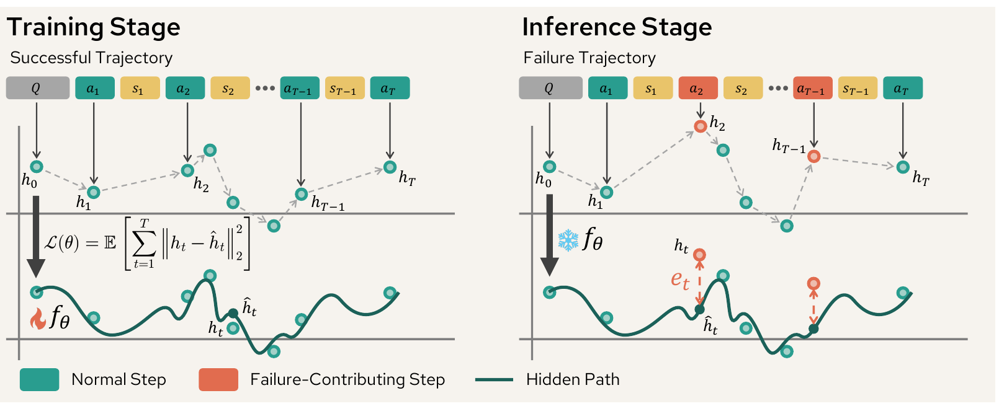

# OAT: Tracing Agentic Failure from the Flow of Success (NeurIPS 2026)

Official codebase of the paper "_Tracing Agentic Failure from the Flow of Success_".

> By [Samuel Yeh](https://mhyeh.github.io/)<sup>1</sup>, Yiwen Zhu<sup>2</sup>, Shaleen Deep<sup>2</sup>, and [Sharon Li](https://pages.cs.wisc.edu/~sharonli/)<sup>1</sup>
> <br/>
> <sup>1</sup>University of Wisconsin–Madison, <sup>2</sup>Microsoft Research

[](https://arxiv.org/abs/2607.12747)
[](https://neurips.cc/Conferences/2026)
[](LICENSE)

## News

- [Sep 2026] The paper is accepted to NeurIPS 2026 🎉
- [Jul 14, 2026] The paper is available on [arXiv](https://arxiv.org/abs/2607.12747), and we release the code and dataset.

## Overview

<p align="center">
  
</p>

**Failure attribution** for LLM-based agentic systems is the task of finding which steps in a failed trajectory caused the task to fail. Existing approaches either rely on expensive prompting pipelines with frontier LLMs, or require post-training on failure trajectories with step-level error annotations, which are costly to collect and hard to scale.

We study **unsupervised failure attribution**: train *only on successful trajectories*, then identify error steps in a failure trajectory at inference time. We propose **OAT** (**O**ne-class **A**gent **T**racing), which casts this problem as one-class learning with Neural Controlled Differential Equations (Neural CDEs):

- **Continuous trajectory modeling.** Each step is represented by the hidden states of an LLM. The sequence of step representations is treated as observations of a continuous latent path, which a Neural CDE learns to reconstruct on successful trajectories.
- **Gated control path.** A learned gate suppresses atypical control signals, which makes the model more robust on trajectories from unseen domains.
- **Step-level anomaly scores.** At inference time, each step of a failure trajectory is scored by its deviation from the learned dynamics of success. Failure-contributing steps are selected by **top-k** or by a **conformal prediction (CP)** threshold calibrated on held-out successful trajectories.

Trained on only ~100 successful trajectories, OAT outperforms prompting frontier LLMs (including GPT-5) by **+20% F1** in-domain and **+7% F1** out-of-distribution. It uses zero tokens at inference and runs **200–5000× faster** than prompting-based baselines with under 1 GB of VRAM.

## Main Results

**In-domain** (train and test on MCP-Atlas):

| Approach | Precision | Recall | F1 | Hit | AUROC | AUPRC |
| --- | --- | --- | --- | --- | --- | --- |
| Random-Step | 0.284 | 0.246 | 0.255 | 0.284 | 0.529 | 0.226 |
| GPT-4o | 0.233 | 0.210 | 0.212 | 0.250 | 0.509 | 0.217 |
| GPT-5 | 0.217 | 0.183 | 0.181 | 0.250 | 0.515 | 0.217 |
| **OAT (Top-k)** | 0.321 | **0.706** | 0.420 | **0.777** | **0.629** | **0.324** |
| **OAT (CP)** | **0.443** | 0.484 | **0.435** | 0.566 | **0.629** | **0.324** |

**Out-of-distribution** (train on MCP-Atlas, test on Who&When):

| Approach | Precision | Recall | F1 | Hit | AUROC | AUPRC |
| --- | --- | --- | --- | --- | --- | --- |
| Random-Step | 0.137 | 0.137 | 0.137 | 0.137 | 0.547 | 0.061 |
| GPT-4o | 0.129 | 0.198 | 0.151 | 0.198 | 0.566 | 0.066 |
| GPT-5 | 0.111 | 0.275 | 0.152 | 0.275 | 0.584 | 0.078 |
| **OAT (Top-k)** | 0.150 | **0.451** | **0.225** | **0.451** | **0.758** | **0.128** |
| **OAT (CP)** | **0.184** | 0.330 | 0.211 | 0.330 | **0.758** | **0.128** |

OAT results are averaged over 5 random seeds. AUROC and AUPRC depend only on the anomaly scores, so they are shared by both detection strategies. See the paper for standard deviations and the full set of baselines.

## Repository Structure

```
OAT/
├── run_pipeline.py      # CLI entry point: extract / baselines / train / ood
├── extract_states.py    # extract step-level hidden states from the proxy LLM
├── data_pipeline.py     # trajectory loading, PCA projection, normalization, CORAL alignment
├── models/
│   └── oat.py           # OAT model: Neural CDE with gated control path
├── train.py             # training, top-k and conformal detection
├── baselines.py         # random-step, first-step, and all-at-once prompting baselines
├── evaluate.py          # precision / recall / F1 / hit rate / AUROC / AUPRC
├── config.py            # paths and hyperparameters
└── dataset/
    ├── MCP-atlas/Qwen3.5-27B/   # MCP-Atlas trajectories sampled with Qwen3.5-27B, with step-level annotations
    └── who_and_when/Who&When/   # Who&When benchmark (Algorithm-Generated and Hand-Crafted)
```

## Installation

```bash
git clone https://github.com/deeplearning-wisc/OAT.git
cd OAT
python -m venv .venv && source .venv/bin/activate
pip install -r requirements.txt
```

The LLM prompting baseline additionally requires `vllm` (local models) or `openai` (Azure OpenAI).

## Data

Both datasets are included in this repository under `dataset/`.

- **MCP-Atlas.** We run Qwen3.5-27B on tasks from the public subset of [MCP-Atlas](https://scale.com/leaderboard/mcp_atlas). A trajectory is successful if it satisfies all rubric claims. We manually annotate the failure-contributing steps of each failure trajectory. Successful trajectories are used for training; failure trajectories are used for in-domain evaluation.
- **Who&When.** The [Who&When](https://github.com/mingyin1/Agents_Failure_Attribution) benchmark contains 184 failure trajectories generated by GPT-4o multi-agent systems, each annotated with the earliest decisive error step. It is used only for out-of-distribution evaluation.

## Quick Start

All commands go through `run_pipeline.py`. Outputs are written to `outputs/`.

### 1. Extract step representations

OAT represents each step with the mean-pooled last-layer hidden states of `Qwen/Qwen3.5-27B`. Extract them once per dataset:

```bash
python run_pipeline.py extract --dataset mcp_atlas
python run_pipeline.py extract --dataset who_and_when
```

Hidden states are cached in `outputs/hidden_states_mean/<dataset>/`. Use `--model-name` to choose a different proxy LLM and `--force` to re-extract.

### 2. In-domain evaluation (MCP-Atlas)

```bash
python run_pipeline.py train --dataset mcp_atlas
```

This trains OAT on 80% of the successful trajectories, uses the remaining 20% for early stopping and conformal calibration, and evaluates on the annotated failure trajectories over 5 seeds. Results are saved to `outputs/results/mcp_atlas/OAT/`.

### 3. Out-of-distribution evaluation (MCP-Atlas → Who&When)

Who&When contains failure trajectories only, so OAT is trained on successful MCP-Atlas trajectories and evaluated on Who&When, with CORAL aligning the target representations to the source:

```bash
python run_pipeline.py ood --train-dataset mcp_atlas --test-dataset who_and_when
```

Results are saved to `outputs/results/ood/mcp_atlas_to_who_and_when/OAT_coral/`.

### 4. Baselines

```bash
# Random-step and first-step baselines
python run_pipeline.py baselines --dataset mcp_atlas

# Also run the all-at-once prompting baseline with a local model through vLLM
python run_pipeline.py baselines --dataset mcp_atlas --include-all-at-once-prompt \
    --llm-backend vllm --llm-model-name Qwen/Qwen3.5-27B

# ... or with Azure OpenAI (set AZURE_OPENAI_ENDPOINT / AZURE_OPENAI_MODEL in config.py)
export AZURE_OPENAI_API_KEY=<your-key>
python run_pipeline.py baselines --dataset mcp_atlas --include-all-at-once-prompt --llm-backend azure
```

### Key options

| Option | Default | Description |
| --- | --- | --- |
| `--latent-dim` | `64` | PCA dimension of step representations |
| `--detection-top-k` | `3` | `k` for top-k detection |
| `--conformal-alpha` | `0.2` | Miscoverage rate `α` for conformal detection |
| `--n-seeds` | `5` | Number of random seeds |
| `--epochs` / `--patience` | `300` / `20` | Training epochs and early-stopping patience |
| `--layer` | `-1` | Hidden-state layer used as the step representation |
| `--aggregation` | `mean` | Token aggregation within a step (`mean` or `last`) |

Other hyperparameters (Neural CDE width and depth, gate architecture, solver, learning rate) are defined in [`config.py`](config.py).

## Citation

If you find this work useful, please consider citing our paper:

```bibtex
@inproceedings{yeh2026tracing,
  title     = {Tracing Agentic Failure from the Flow of Success},
  author    = {Yeh, Samuel and Zhu, Yiwen and Deep, Shaleen and Li, Sharon},
  booktitle = {Advances in Neural Information Processing Systems},
  year      = {2026}
}
```

## Acknowledgements

We thank the authors of [MCP-Atlas](https://scale.com/leaderboard/mcp_atlas) and [Who&When](https://github.com/mingyin1/Agents_Failure_Attribution) for releasing their benchmarks, and the authors of [torchcde](https://github.com/patrick-kidger/torchcde) for their Neural CDE library.

## License

This codebase is released under the [MIT License](LICENSE). The MCP-Atlas and Who&When datasets are subject to their original licenses.
